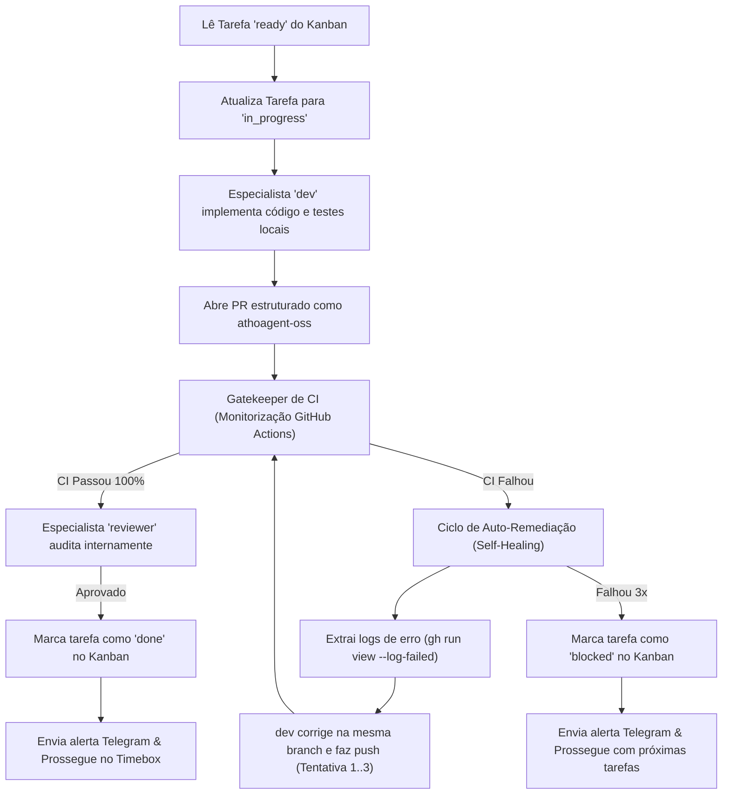

# 1. Motor de Execução de Ondas Autónomas (Athos Wave Engine)

Documento de arquitetura técnica e governança operacional do motor de execução autónoma do Athos na VPS Debian 12 (`198.244.188.203`).

---

## 1. Princípios Cardeais & Governança

1. **Regra Inegociável do Fundador (Deploy & Merge Exclusion)**:
   - Os agentes (`dev`, `reviewer`, `auditor`, etc.) têm total autonomia para criar branches isoladas, implementar código, correr testes unitários locais, abrir Pull Requests e validar CI.
   - **É ESTRITAMENTE PROIBIDO aos agentes fundir branches na `main` ou executar comandos de deploy em produção**.
   - Deploys e merges são decisões administrativas exclusivas do **Ricardo Varzim (Fundador)**.
2. **Isolamento de Identidade GitHub**:
   - Commits, pushes e abertura de PRs devem usar estritamente a conta de agente: **`athoagent-oss`** (`athoagent-oss@users.noreply.github.com`).
   - A autenticação do GitHub CLI (`gh`) na VPS está configurada por defeito em `~/.config/gh/hosts.yml` com o token do `athoagent-oss` (`ghp_okm...`).
   - Variáveis `GH_TOKEN`, `GITHUB_TOKEN` e `AGENT_GH_TOKEN` são exportadas no ambiente global da VPS (`~/.bashrc` e `~/.hermes/.env`).
   - `RicardoVarzim` é o utilizador exclusivo de revisão e aprovação final.
3. **Auditoria Interna (Zero Comentários no GitHub PR)**:
   - O especialista `reviewer` faz auditoria dos diffs, conformidade com os Critérios de Aceitação (ACs) e segurança de forma **100% interna**.
   - **Nunca comentar nem aprovar no PR do GitHub**. As avaliações são enviadas para o Telegram do Ricardo e gravadas no Kanban.

---

## 2. Arquitetura do Loop com Auto-Remediação (Self-Healing)

O script principal reside em `~/.hermes/scripts/autonomous-loop.py` (cópia mestre em `playbooks/scripts/autonomous-loop.py`).

### Fluxo de Execução por Tarefa

### Funcionalidades Chave do Motor
1. **Self-Healing Loop**:
   - Quando o CI falha (ex.: erro de compilação, asserção xUnit ou namespace em falta), a função `get_ci_failed_logs` descarrega o trecho relevante do log de falha e re-despacha o `dev` para resolver o problema na mesma branch.
   - Limite de 3 tentativas de autocura antes de sinalizar bloqueio.
2. **Resiliência do Timebox**:
   - Se uma tarefa esgotar as tentativas e ficar `blocked`, o loop **não aborta a onda com `break`**.
   - Regista o bloqueio, alerta o Telegram e avança para a próxima tarefa pronta no backlog, garantindo o aproveitamento total das 1.5 horas planeadas.
3. **Template Estruturado de PR**:
   - Todo o PR gerado deve conter:
     - `## 🎯 Objetivo`
     - `## 🛠️ Alterações Realizadas`
     - `## 🧪 Evidência de Testes Locais`
     - `## 🛡️ Salvaguardas & Governança`
